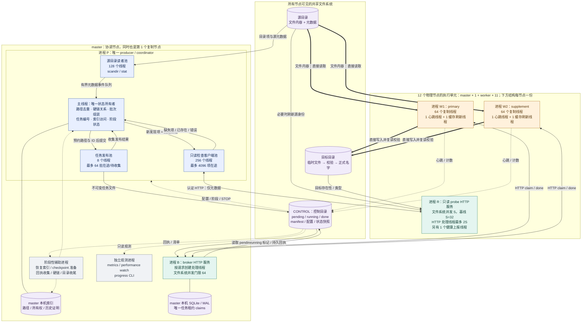

# 多节点共享存储复制架构

本文只解释系统由哪些进程、线程和存储组成，它们如何协作，以及并发在哪里受到约束。进度、性能分析和完成预测见 [迁移报告](report_20261022.md)。

以 2026-10-22 的优先级 3 恢复架构为主线。下文“配置基线”取北京时间 18:32 的只读配置/状态：12 个物理节点、每节点 primary 64 路加 supplement 64 路、源目录扫描 128 线程、目标检查客户端 256 线程、最多 4096 个在途检查、8 个发布线程、64 个在途发布。它是参数快照，不表示所有池始终满载；部署版本须再以控制目录的部署记录和真实进程 argv 核实。

## 1. 总体结构：控制任务与搬运内容分开

系统中有三个不同角色：

- **producer / coordinator** 发现文件、确定哪些文件需要处理、生成批次和推进阶段。
- **broker** 把批次唯一分配给复制线程，并确认其回执。
- **worker** 打开源和目标文件，完成内容复制、校验及发布。

producer 和 broker 都在 master，但它们是不同进程。master 自身也运行一组普通 worker 和只读 probe，因此“12 个复制节点”包含 master，另外 11 个是 worker 节点。共享源和目标对所有执行节点可见，不需要先把内容传到 master 中转。

### 架构图

图中实线为任务、元数据或数据流，虚线为状态读取、观测或阶段性协作。颜色区分职责；节点框表示部署位置，嵌套框表示同一进程内的线程角色。图中的数字采用上面的配置基线；可选多进程模式单独在后文说明。

图中 master 的执行单元画在下方公共区域，是为了只画一份重复结构；不是额外增加第 13 个节点。控制目录与目标数据目录通常落在同一共享目标存储上，但职责不同。

## 2. 主节点上的 producer：并行发现，单点决定

当前恢复入口是 `migration_interleaved_target_filter.py`，它复用并行扫描、分布式目标检查和有界任务发布组件。它是一个协调进程，不是为每个复制节点各启动一个 producer。

### 2.1 主线程：唯一任务与状态所有者

主线程消费扫描事件和检查结果，维护路径去重集合、硬链接关系、任务编号、分配账本、迁移索引和阶段计数。只有它决定某条路径是否已经预约、是否应生成任务、采用哪个任务 ID，以及何时发布扫描完成。

新发现项与历史未完成候选进入同一套预约和检查路径。历史候选可优先安排大文件，但不会绕开路径去重另起一套生产者。扫描器的 `on_tick` 回调也由调用扫描器的主线程执行，用来穿插历史候选、收集结果和发布任务，不是额外的后台生产线程。

SQLite 操作并不全归 broker：**producer 的迁移/恢复索引**用于路径和成功证明，**broker 的租约库**用于唯一分配。二者是不同数据结构、不同所有者，不能互相替代。

### 2.2 源目录读者池：128 个线程

`migration_parallel_scan.scan_phase()` 在配置基线下创建 128 个 `scan-dir-*` 线程，负责打开目录、`scandir`、读取文件类型和源元数据，并把事件送回主线程。读者不分配任务 ID、不更新迁移索引，也不执行文件内容复制。

进程内有目录工作队列和元数据事件队列，默认各最多 8192 个队列项。读者等待队列空间形成背压；这不是无限地将整棵树加载进内存。单个目录线程可能在其本地栈继续遍历子目录，因此队列长度不是“打开目录 FD 总数”的精确上限。

已种入恢复清单的非目录项可以减少重复元数据操作；目录仍继续遍历，避免漏掉新子项。优先级 3 在扫描时排除优先级 1、2 的子树。

### 2.3 只读目标检查客户端池：256 线程，4096 项在途

客户端线程将检查请求通过认证 HTTP 发送到各节点的 probe。probe 判断目标是否存在、类型是否合适，并在必要时刷新源身份。返回结果由主线程收集，再决定是否组装复制任务。

**256 是本机执行线程上限，4096 是已提交但尚未收集的条目上限**，后者包括等待执行和已完成未收集的结果，不表示 4096 个 HTTP 请求都在同时执行。远端端点出错会重试其他节点，最终回退本地检查；失败不能被解释成“目标已有”或“目标缺失”。

存在性预检不读全文件计算摘要，也不是最终副本成功证明。worker 的内容校验和正式轮次仍是另一层职责。

### 2.4 任务发布池：8 线程，64 批在途

`BoundedTaskPublisher` 只负责把已经由主线程预约好路径和任务 ID 的 payload 发布成独立的新任务文件。发布线程不访问 producer 的 SQLite，不重新分配 ID，不写全局扫描计数。

默认一批最多 64 个条目或累计约 1 GiB；单个大于 1 GiB 的文件仍作为独立条目处理，不拆成并行字节区间。恢复供给可提前刷新不足一批的条目，避免等待凑满。

64 的容量包含运行中、排队中和已完成待主线程收集的发布。只有收集成功才增加已发布计数；失败会停止新提交并等待已接受写入结束，保留编号和现场。发布池的 64 批与复制线程的 1536 路不是同一个队列容量。

## 3. broker：唯一租约服务，不转发文件内容

`migration_broker_parallel.py` 是 master 上的独立 HTTP 服务，复用原 broker 的 API。主线程运行 HTTP accept/service 循环，每个请求交给一个处理线程。当前实现没有给 broker 的 HTTP 处理线程设置固定池大小；`request_queue_size=1024` 是监听 backlog，不能解释成 1024 个执行线程。

broker 的共享存储操作受 `broker_fs_concurrency` 信号量限制，配置基线为 64。数据库临界区通过锁串行化；按 `(stage, owner)` 和 `(stage, task_id)` 的锁分别保护领取幂等和回执提交。慢共享盘操作不持有整个 SQLite 数据库锁，因而可以与其他独立请求并发。

租约库位于 master 本机 `/tmp/<run_id>-broker.sqlite`，使用 SQLite/WAL，`(stage, id)` 是任务主键。共享目录中的 pending/running/done 用于任务和回执持久化，**不靠 NFS 文件改名决定哪一个节点抢到任务**。

- `GET /claim`：同一 owner 有未完成租约时返回原任务和原 lease；否则分配一个任务。
- `POST /done`：校验 lease、任务 ID 和结果覆盖的条目，先持久化回执，再更新数据库为 done；同一完成请求重试是幂等的。
- `/control`：管理 drain 等领取屏障，使指定节点暂不领取新任务，供滚动替换使用。

`migration_broker_sharded.py` 是同一 broker 的可选分片实现：新租约的 running 标记写入 `running/<id%64>/`，减少单个目录的元数据争用；已有租约继续使用数据库记录中的原 running 路径，不迁移或重写其租约。`queued_count()` 同时识别旧平铺标记和新分片标记，并拒绝符号链接等异常队列项；分片不会增加 broker 实例数或改变唯一分配权威。

本机租约库和锁随 master 的故障域走，共享回执随共享存储的故障域走。master 丢失本机状态后的恢复需要显式隔离与重建，不是任意节点直接打开同一个 NFS SQLite 文件接管。

## 4. 每个执行节点：两个复制进程和一个只读 probe

### 4.1 primary 与 supplement 是两个 OS 进程

| 每节点进程 | 线程角色 | 并发与所有权 |
| --- | --- | --- |
| primary | 主线程管理生命周期；复制线程池；心跳线程；状态缓存刷新线程 | 池最大 64 个复制线程；owner 为 `host-0` 至 `host-63` |
| supplement | 同上，独立进程、独立锁和限速器 | 池最大 64 个复制线程；owner 为 `host-64` 至 `host-127` |
| probe | HTTP 主循环；请求处理线程；健康上报线程 | 文件系统操作最多 S 路，HTTP 请求处理最多 2S 路 |

`migration_cached_worker.py` 通过 `runpy` 在当前进程内运行 primary 或 supplement 实现，**不是再启动一个子 worker 进程**。它额外创建一个缓存刷新线程，只缓存当前控制目录的 `state.json`。

心跳线程默认约每 3 秒更新节点状态、活跃条目和累计计数，读取调优配置并响应停止状态；缓存线程默认每 0.5 秒刷新阶段状态。缓存过期或刷新失败拒绝继续领取新任务。STOP、配置、回执等不经这个 state 缓存。代码默认缓存有效期 3 秒，滚动工具目标是 30 秒，实际值以各进程 argv 为准。

因此配置总复制并发是 `12 × (64 + 64) = 1536`，**不是 OS 线程总数**。master 还有 producer/broker，所有节点还有心跳、缓存和 probe 线程。

### 4.2 一个复制线程从领取到回执始终占用一个工作槽

每个复制线程使用自己的 owner 向 broker 领取一批任务，按顺序处理该批内的条目，然后提交一份包含全部条目结果的回执。批内文件不再分派给另一层线程池；一个大文件也不拆成多个线程复制。

普通文件的完整路径为：

1. 打开源文件，在目标目录创建唯一临时文件。
2. 以最多 8 MiB 的块读取源内容，边读边做 SHA-256；写目标，整块全零可通过 seek 保留稀疏空间。
3. 复读目标临时文件校验摘要，并复核源身份、保留元数据、`fsync`。
4. 用目标临时文件到正式名字的硬链接发布，清理临时名字；符合显式所有权条件的更新另走受保护替换路径。
5. 汇总条目结果，向 broker 提交相同任务/lease 的回执；收到成功答复后才能领取下一批。

SHA、写入、目标复读和 `fsync` 都由同一个复制线程串行执行，没有单独的“校验线程池”。符号链接、已有目标以及硬链接收尾有各自处理分支。

`/done` 回复丢失时，线程保留原 payload 重试，不重新复制、也不另领任务。因此活跃槽位可能在读写文件，也可能在等待回执确认。文件数据始终由执行节点直接访问共享源和目标；broker 的 HTTP 只携带任务描述和回执。

限速器在每个复制进程内共享，读源、写目标和目标校验都消费该进程的 I/O 预算，不是每个线程独享一份预算。主进程和补充进程各有独立预算；逻辑预算也不能等同于物理盘带宽。

### 4.3 probe：把元数据检查分散到数据可见的节点

每节点的 `migration_target_probe.py` 是独立进程，服务只读、认证后的范围内检查，不领取复制任务、不更新分配索引、不写目标内容。

设 `slots=S`：文件系统检查信号量最多 S 路；HTTP 处理线程通过另一信号量最多 2S 路；另外有一个健康上报线程。这里 HTTP 线程数与实际文件系统并发有意分开。代码默认 S=32，当前代码支持 1–128，滚动工具可调整到 64；是否已生效应读取各节点 health，不能由源码上限推断。HTTP 饱和会返回 Busy，而不是无限创建处理线程。

可选 STOP 缓存最多 0.1 秒，同进程线程共享，看到 STOP 后保持停止；它不缓存“目标存在”结果。

## 5. 两类存储状态及其所有者

| 状态 | 位置 | 唯一写入/决定者 | 消费者 |
| --- | --- | --- | --- |
| 文件内容与文件元数据 | 源/目标共享目录 | 源由外部业务更新；目标由 worker 或受控收尾逻辑写入 | worker、扫描、probe |
| manifest、路径预约账本、任务 ID | 共享控制目录及 producer 内存 | 单一 producer 主线程 | 恢复、阶段收尾、观测 |
| 迁移/恢复索引 | master 本机 SQLite 或候选库 | 当前阶段指定的主线程或恢复 helper，按交接切换 | producer、恢复与收尾 |
| claims/lease | master 本机 SQLite/WAL | broker | broker 请求处理线程 |
| pending 任务 | `CONTROL/stages/<stage>/pending/<id%64>/` | producer 的发布池，只发布各自唯一 ID | broker |
| running 标记、done 回执 | 同阶段控制目录，按 64 分片组织 | broker | 恢复、收尾、观测 |
| 阶段状态与配置快照 | `state.json`、`config.json` 的不可变版本 | 指定状态发布者/运维入口 | worker、broker、观测 |
| 节点心跳与计数 | `nodes/`、`nodes-extra/` | 对应 primary/supplement 进程 | metrics、progress |

控制目录 JSON 使用 `migration_io` 发布唯一不可变版本，由 `read_json()` 选择最新版本。canonical 文件可能停留在第一次创建，不能直接 `json.load` 后当成当前状态。`flock` 用于主机本地角色互斥，不是跨节点共享存储锁。

## 6. 恢复、阶段收尾与观测进程

这些角色不应和稳定复制主链路中的常驻线程全部相加：有些只在恢复或阶段转换时存在，有些部署后已结束。

| 角色与入口 | 生命周期、线程及作用 |
| --- | --- |
| 历史恢复 helper：`migration_overlap_resume.py seed` 等 | 恢复期间独立子进程，读取祖先回执并构建候选索引，完成后由协调逻辑合并。并行内存索引实现默认 64 个回执读线程、最多 128 份在途读取；合并/数据库写入保持确定顺序，不是 64 个线程同时写同一索引。具体 reader 实现由部署入口选择。 |
| checkpoint 准备：`migration_prepared_resume.py` | 独立阶段性进程，在旧 producer 运行时读取稳定前缀、保存路径/硬链缓存、候选 spool 和摘要；不发布任务、不获取租约。交接后 producer 校验并加载缓存，补齐清单尾部与分配增量。 |
| 回执收集、硬链、目录收尾：`migration_pipeline_v2.py` helper | coordinator 管理后台 job；每个 job 由管理线程启动一个独立 helper 子进程。收集/硬链 job 按 stage 去重，目录元数据是独立 job。各阶段可与其他阶段复制重叠，实际进程数随阶段变化，没有一个固定的全局“收尾 64 路”参数。 |
| 独立清点：`migration_inventory.py` | 按节点分配目录清点工作，产生 inventory；不是实际复制的任务分配者，可能未部署或未完成。 |
| metrics：`migration_metrics.py` | 单独采样进程，汇总节点计数和历史速率；可另有 1 个 `inventory-summary` 线程汇总清点。 |
| performance watch：`migration_performance_watch.py` | 独立观测循环，根据连续有效采样判断工作负载和低速事件，不自动部署、重启或增加并发。 |
| progress：`migration_progress.py` | 用户启动的 CLI 进程，单次读取或 watch；聚合 primary/supplement 为物理节点，无调度权。 |
| watchdog：`migration_watchdog.py` | 可选训练保护进程；启用时观察训练并可写 STOP，不能当作完全只读观测。当前配置明确禁用训练耦合，入口会退出；复制自己的 STOP 机制仍存在。 |

正式轮次由 coordinator 在扫描、等待复制、回执收集和元数据收尾之间推进。当前 `recovery_warm` 的 `p3-r3` 标签属于恢复队列，不能仅凭标签中的 `r3` 认定正式第三轮已经验收。

## 7. 可选进程模式：并行资源改变，唯一所有者不变

工作树还提供两类多进程扩展。它们不是上图基线默认同时启用的额外能力。

- **元数据客户端多进程**：`migration_probe_processes.ProcessProbePool` 通过 spawn 启动 P 个子进程，每个子进程有 T 个只读客户端线程，处理批量 probe，结果通过进程间通信返回父进程。代码支持 P=1–32、T=1–128；配置缺省 `metadata_client_processes=0` 时仍使用基线单进程线程池。潜在客户端并行度还受批次大小、总在途条目数和远端 slots 限制，不能只用 P×T 认定实际请求数。子进程不打开分配账本或迁移索引，不发布复制任务。
- **源目录多进程读者**：`scan_phase(processes=...)` 可委托 `migration_process_scan.py` 的 spawn 读者，子进程进行目录读取和元数据工作，经有界 IPC 返回父进程。缺省 `processes=0` 仍为扫描线程模式。seeded 路径集合、manifest、硬链统计及任务回调留在父进程；不是多个独立 producer。必须由实际调用入口传参才生效。

这两种扩展仍部署在调用它们的主机上，不能称为“12 节点分布式源目录扫描”。分布式的是各节点的 probe 和复制执行。

## 8. 并发数字如何对应到一份文件

| 层级 | 配置基线 | 调度单位 | 不应误解为 |
| --- | ---: | --- | --- |
| 源目录扫描 | 128 读者线程 | 目录遍历、元数据事件 | 128 个文件内容复制流 |
| 客户端检查 | 256 线程 / 4096 项在途 | 一条路径的只读检查 | 4096 个同时执行的 HTTP 请求 |
| 每节点 probe | S 个 FS 槽 / 2S 个 HTTP 处理槽 | 请求与元数据操作 | S 个复制线程 |
| 任务发布 | 8 线程 / 64 批在途 | 一个新 pending 文件 | 64 个全局待复制批次上限 |
| broker | HTTP 请求线程 / 64 个 FS 槽 | claim、done、control | 固定 64 个 HTTP 工作线程 |
| 每节点复制 | primary 64 + supplement 64 | 每线程一批，批内逐文件处理 | 每个文件再开 128 线程 |
| 全集群复制 | 1536 个配置工作槽 | 领取、复制、校验、提交回执 | 1536 条持续满速写入流 |

端到端是一条带背压的流水线：源发现 → 只读预检 → 唯一路径预约与组批 → 有界发布 → broker 唯一租约 → 逐文件复制校验 → 持久回执 → 阶段收尾。任一上游队列没有可用工作，下游即使有空闲线程也会等待；任一下游积压，上游应在有界队列处等待。系统通过这种边界保留唯一分配、有限内存和可恢复的成功证据。

## 代码入口索引

- producer 主循环：[migration_interleaved_target_filter.py](../migration_interleaved_target_filter.py)；发布：[migration_task_publisher.py](../migration_task_publisher.py)。
- 源扫描：[migration_parallel_scan.py](../migration_parallel_scan.py)；目标检查客户端：[migration_distributed_target_filter.py](../migration_distributed_target_filter.py)。
- broker：[migration_broker_parallel.py](../migration_broker_parallel.py)、[migration_broker.py](../migration_broker.py)。
- worker：[migration_run.py](../migration_run.py)、[migration_worker128_run.py](../migration_worker128_run.py)；文件操作：[migration_worker.py](../migration_worker.py)。
- 缓存包装与刷新：[migration_cached_worker.py](../migration_cached_worker.py)、[migration_state_cache.py](../migration_state_cache.py)；probe：[migration_target_probe.py](../migration_target_probe.py)。
- 恢复准备：[migration_prepared_resume.py](../migration_prepared_resume.py)；流水线收尾：[migration_pipeline_v2.py](../migration_pipeline_v2.py)；状态发布：[migration_io.py](../migration_io.py)。
